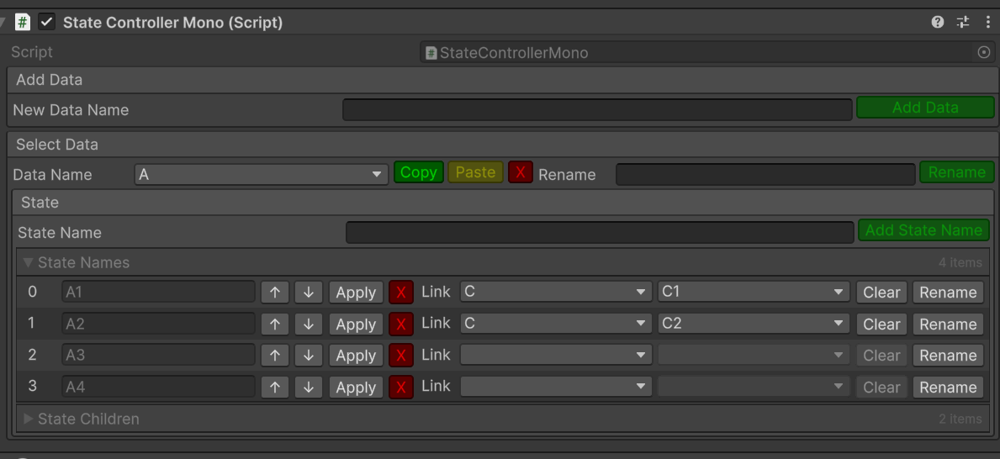

# StateController 状态控制器

参考 FairyGUI 控制器实现的通用状态控制器，支持任意 Binding 扩展。适用于 UI 状态切换、角色状态管理、场景状态控制等场景。

## 特性

- 支持将 Group 的不同 State 映射为任意类型的值
- 支持布尔值的 Single、And、Or 组合
- 支持 State 之间的自动 Link 切换
- 支持编辑器实时预览

## 交流 QQ 群：949482664

## 核心组件

### 1. `StateController`

主控制器组件，挂载在 GameObject 上，管理多个 `StateGroup` 及其 `StateBinding`。

### 2. `StateValueBinding<T>`

值绑定基类，根据 Group 的当前 State 查找对应的 `T` 值，并将值应用到目标对象。

```csharp
// 示例：根据当前 State 切换图片
[RequireComponent(typeof(Image))]
public class ExampleImageSpriteBinding : StateValueBinding<Sprite>
{
    private Image m_TargetImage;

    protected override void InitializeTarget()
    {
        m_TargetImage = GetComponent<Image>();
    }

    protected override void ApplyValue(Sprite value)
    {
        m_TargetImage.sprite = value;
    }
}
```

### 3. `BooleanStateBinding`

布尔绑定基类，支持 `Single`、`And`、`Or` 三种模式。

```csharp
// 示例：根据布尔结果控制 GameObject 激活状态
public class ExampleGameObjectActiveBinding : BooleanStateBinding
{
    private GameObject m_TargetGameObject;

    protected override void InitializeTarget()
    {
        m_TargetGameObject = gameObject;
    }

    protected override void ApplyValue(bool value)
    {
        m_TargetGameObject.SetActive(value);
    }
}
```

## 使用方法

### 基本使用

```csharp
// 获取控制器
StateController controller = GetComponent<StateController>();

// 通过名称设置当前状态
controller.SetCurrentStateName("GroupName", "StateName");

// 通过索引设置当前状态
controller.SetCurrentStateIndex("GroupName", 0);

// 获取当前状态
string currentName = controller.GetCurrentStateName("GroupName");
int currentIndex = controller.GetCurrentStateIndex("GroupName");

// 获取所有状态名
string[] stateNames = controller.GetStateNames("GroupName");
```

### 直接操作 Group

```csharp
// 获取 Group
StateGroup group = controller.GetGroup("GroupName");

// 设置当前状态
group.CurrentStateName = "StateName";
group.CurrentStateIndex = 0;

// 监听当前状态变化
group.CurrentStateNameChanged += name => Debug.Log($"State changed to: {name}");
group.CurrentStateIndexChanged += index => Debug.Log($"Index changed to: {index}");
```

### 编辑器预览

点击 Inspector 中的 **Apply** 按钮可实时预览状态效果。



## 内置 Binding

| 类名 | 功能 |
|------|------|
| `GameObjectActiveBinding` | 控制 GameObject 激活状态 |
| `ImageSpriteBinding` | 切换 Image 的 Sprite |
| `ImageSpriteColorBinding` | 切换 Image 的 Sprite 和颜色 |
| `RectTransformAnchoredPositionBinding` | 控制 RectTransform 的 anchoredPosition |
| `TextContentBinding` | 切换 Text 的文本内容 |

## 安装方式

通过 Unity Package Manager 安装：

1. 打开 Window > Package Manager。
2. 点击 "+" 按钮，选择 "Add package from git URL..."。
3. 输入：`https://github.com/XuToWei/StateController.git`。

## 依赖

- Unity 2020.1+（状态映射使用泛型序列化，需 2020.1 及以上）
- [Odin Inspector](https://assetstore.unity.com/packages/tools/utilities/odin-inspector-and-serializer-89041)（收费插件，请自行购买安装）

## 许可证

MIT License
